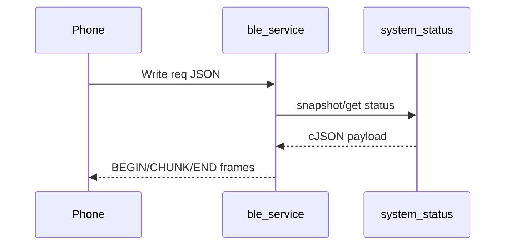

# ble_service Component

Back to project guide: [../../README.md](../../README.md)

## What This Component Does

`ble_service` exposes a custom BLE service with:
- RX characteristic (write/read)
- TX characteristic (notify)

It sends JSON responses and supports command-based requests from BLE terminal apps.

## BLE Messaging Flow



## Framing Format

Large TX payloads are framed as:
- `BEGIN:<msgId>:<totalBytes>:<maxChunkBytes>`
- `CHUNK:<msgId>:<index>/<total>:<data>`
- `END:<msgId>`

## Beginner Commands

Plain text:
- `STATUS`
- `STATUS FULL`
- `STATUS COMPACT`
- `MODE FULL`
- `MODE COMPACT`

JSON request example:

```json
{"id":1,"type":"req","cmd":"system.status.get","params":""}
```

## Wi-Fi Provisioning

Write a credentials request to the RX characteristic after pairing and enabling TX notifications:

```json
{"id":7,"type":"req","cmd":"wifi.credentials.set","params":{"ssid":"MyNetwork","password":"your-password"}}
```

SSID must be 1–32 bytes; password may be empty for an open network and may be up to 64 bytes. The device first sends a `wifi.credentials.result` event with status `accepted`, then sends a terminal result with status `connected` or `failed`. Rejected requests use status `rejected` and a reason such as `invalid_request` or `busy`. The password is never returned.

The candidate network is tested asynchronously. Credentials are saved to NVS only after the station connects and obtains an IP address. If the trial fails, the device restores the previous Wi-Fi configuration, or returns to AP fallback when there was no previous station configuration. Use a BLE write with response and wait for the terminal TX event.

Credential writes require an encrypted, authenticated BLE bond. The current pairing passkey is still the fixed `123456`; replace it with a per-device commissioning secret before production deployment.

## OTA Updates

After pairing, enabling TX notifications, and establishing an encrypted, authenticated BLE bond, write one of the existing OTA requests to the RX characteristic:

```json
{"id":11,"type":"req","cmd":"ota.manager.update.github","params":{"url":"https://raw.githubusercontent.com/Nino67/Esp32-S3-HotTub-Base/main/firmware/hot_tub_controller.bin"}}
```

For debugging, the plain-text command `ota-update` starts the same GitHub firmware update using the URL above. It also requires an encrypted, authenticated BLE bond; the existing JSON OTA commands remain available.

The direct firmware request accepts an optional `storage_url`; when omitted, the OTA manager derives the storage image URL from the firmware URL. To use the versioned manifest flow instead:

```json
{"id":12,"type":"req","cmd":"ota.manager.update.manifest","params":{"manifest_url":"https://example.com/firmware/manifest.json"}}
```

Both URLs and any provided storage URL must use HTTPS. The device first sends an `ota.manager.update.result` event with status `accepted`, followed by `completed` or `failed` if the update routine returns. A successful firmware update reboots the device. Only one BLE OTA request can run at a time; requests during an update are rejected as `busy`.

### Serial Monitor Diagnostics

Set the serial monitor log level to `INFO` or `DEBUG` and watch for the `ble_service` and `ota_manager` tags. A successful request should log the RX write, `Received BLE ota-update`, `BLE OTA request accepted`, `Starting GitHub OTA requested over BLE`, and then `OTA HTTP connection established` with firmware download progress. If the connection is not paired and bonded, the log says `Rejecting ota-update`; if the request reaches the OTA manager but fails, it logs the OTA error.

## Connect Behavior

On BLE connect/subscribe, the component sends a short network summary with current mode, SSID, and IP.

## Troubleshooting

- If output looks truncated, reassemble CHUNK frames.
- If no TX appears, ensure notifications are enabled in your BLE app.
