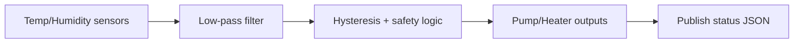
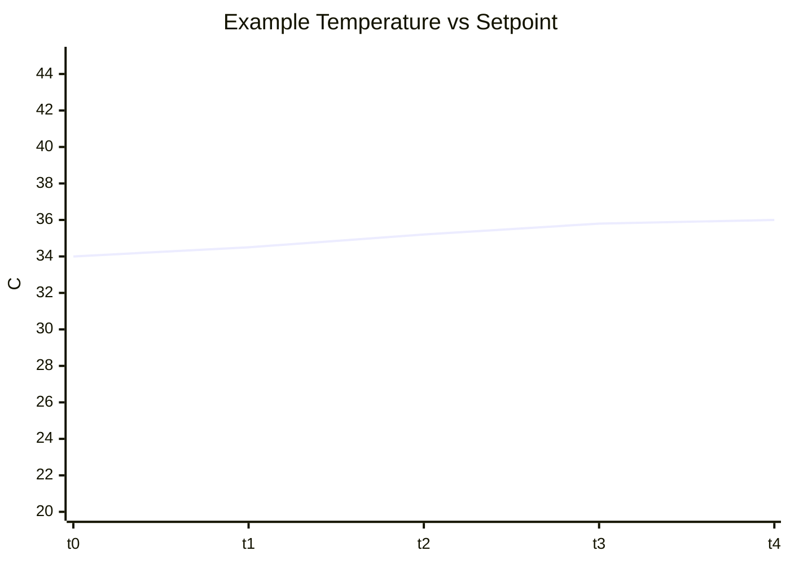

# hot_tub_controller Component

Back to project guide: [../../README.md](../../README.md)

## What This Component Does

`hot_tub_controller` contains the core control logic for water temperature, pump behavior, and heater decisions.

## Control Loop Overview

## Beginner Explanation

The control loop repeats forever:
1. read sensors
2. smooth noisy readings
3. compare against setpoint
4. toggle outputs with hysteresis rules

## Key Data Fields

- `waterTemp`
- `filteredWaterTemp`
- `airTemp`
- `setpointTemp`
- pump/heater state
- optional heat time-control enable flag and start/stop hours

When the DS18B20 is unavailable or a read fails, the controller continues running and pump controls remain available. The heater state and GPIO output stay off until a valid sensor reading clears the fault; the web dashboard displays a sensor error instead of the temperature. Simulation mode does not bypass this heater interlock.

When time control is enabled, automatic heating is allowed only during the configured local-time window. Overnight windows are supported; start is inclusive and stop is exclusive. The feature is disabled by default (12:00 start, 06:00 stop). If local time is unavailable, heating remains allowed.

## Example Behavior Plot

## Troubleshooting

- Oscillation usually means hysteresis thresholds are too tight.
- Flatline temperatures suggest sensor path or conversion issue.
