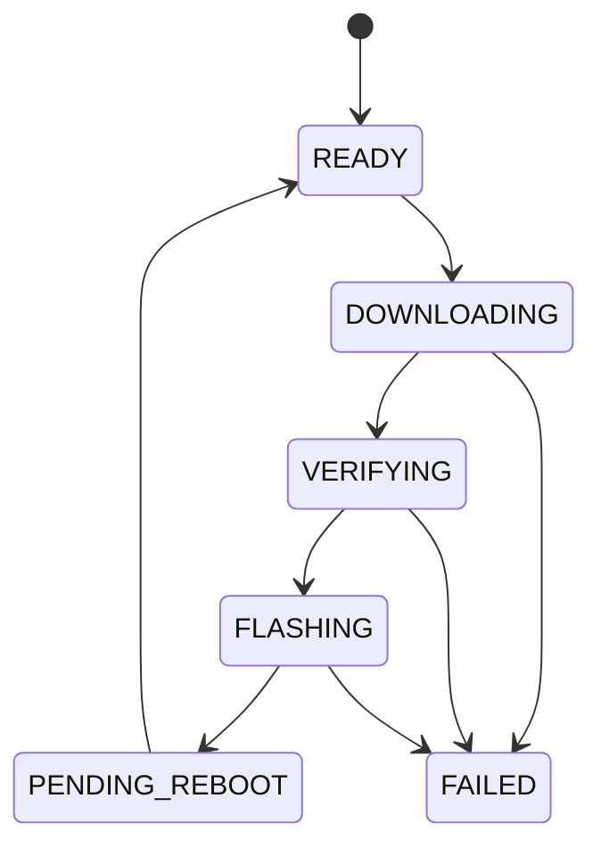

# ota_manager Component

Back to project guide: [../../README.md](../../README.md)

## What This Component Does

`ota_manager` handles over-the-air firmware updates, boot validation, and rollback safety.

## OTA State Flow

## Beginner Explanation

OTA means updating firmware without a USB cable. Safety steps reduce risk of bricking.

Only one OTA request can run at a time across BLE and web clients. OTA URLs (and any storage URL) must use HTTPS on every path, including web requests. The update prepares the storage image for the inactive app slot before downloading and selecting the new firmware; it leaves the currently mounted storage untouched. If the target storage partition is already mounted (for example, because LittleFS mounted the fallback partition), the update is rejected rather than erasing a live filesystem. A web request is acknowledged when queued and reports progress asynchronously.

## Troubleshooting

- If update fails, inspect download URL and partition size.
- If target storage is reported as mounted, restore the active slot's storage and reboot before retrying OTA.
- If rollback occurs, app may not have been marked valid after reboot.
