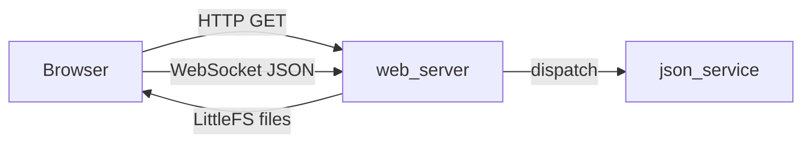

# web_server Component

Back to project guide: [../../README.md](../../README.md)

## What This Component Does

`web_server` serves static UI files from LittleFS and handles WebSocket JSON traffic.

## HTTP + WebSocket Flow

## Beginner Explanation

The web page you open in a browser is hosted by this component. After page load, real-time updates happen through WebSocket.

Status publications include `sample_seq` and `sample_time_ms` (Unix milliseconds at the device). The chart plots each received publication, marks gaps and disconnections, and shows when data is stale. If the device clock is not yet synchronized, the browser uses its receive time; historical samples are not stored or replayed after reconnect.

The serial log reports cumulative `WS dropped count` and `WS send failure count` messages for skipped broadcasts and asynchronous send failures. Counts are logged on the first event and every tenth event. They reset at reboot.

Web-initiated OTA requests run in a background task rather than blocking the HTTP server. The immediate WebSocket response indicates whether the request was accepted; OTA progress and failures are published separately. Only one OTA request can run at a time across web and BLE.

## Performance Design

- **No Nagle delay.** `TCP_NODELAY` is set on every accepted socket. The HTTP server sends each WebSocket frame as a header write plus a payload write; with Nagle enabled the payload could wait for the browser's delayed ACK (tens to hundreds of milliseconds per message).
- **Static files.** Files up to 32 KB are sent in one `Content-Length` response; larger files use 4 KB chunks. A pre-compressed `<file>.gz` is preferred when present (the build stages gzip copies, see [tools/stage_www.py](../../tools/stage_www.py)). Responses carry `Cache-Control: no-cache` and an `ETag` derived from a CRC of the stored file, so browsers revalidate and receive `304 Not Modified` unless the file changed. The ETag CRC is computed once per file per boot.
- **Sockets.** Up to 12 sockets are open at once (`LWIP_MAX_SOCKETS` is 20) so a browser's parallel connections do not purge the WebSocket. The browser also sends a `ws.keepalive` message every 5 s and reconnects after 15 s without any message, which keeps an otherwise receive-only socket from looking idle.
- **Core placement.** The HTTP server runs on core 1; Wi-Fi, lwIP and BLE use core 0.
- **Status counters.** `system.status.get` reports `web_server` (`is_running`, `active_connections` = open WebSocket clients, `total_requests_served`, `file_not_found_404s`) and `storage` (mounted, total and used bytes).

## Practical Steps

1. Connect device and browser to same network.
2. Open board IP in browser.
3. Watch JSON status updates and send commands.

When STA has failed and the recovery AP is active, connect to the `HotTub-Controller` Wi-Fi network and open `http://192.168.4.1/`. The web server is started independently of STA/AP mode, so it remains available through the recovery AP.

## Troubleshooting

- If page loads but no live data, inspect WebSocket connection path.
- If static files are stale, reflash LittleFS assets and hard-reload the page.
- If chart data is missing, check the browser's chart status and serial `WS dropped` / `WS send failure` counts.
- If STA credentials fail repeatedly, use the recovery AP at `192.168.4.1` and provision working credentials over BLE.
