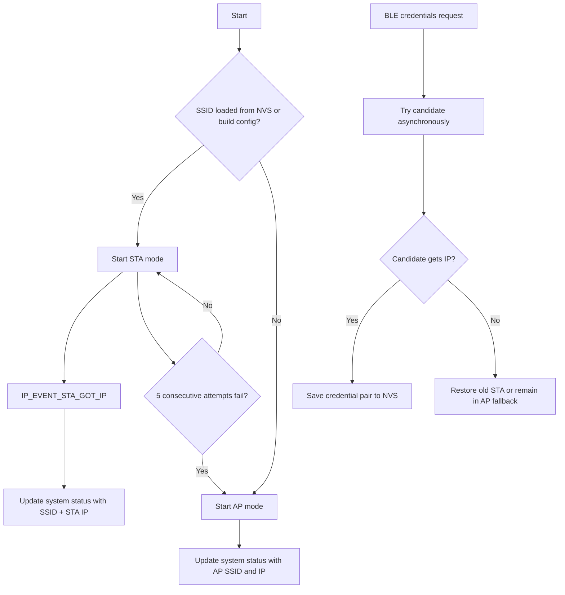

# wifi_manager Component

Back to project guide: [../../README.md](../../README.md)

## What This Component Does

`wifi_manager` starts and monitors Wi-Fi in one of two modes:
- STA mode (connect to existing router)
- AP fallback mode (board hosts its own network)

It tracks STA/AP IP info, publishes wireless status into `system_status`, and accepts BLE-triggered credential trials without blocking the BLE receive callback.

## Mode Decision Flow

## Beginner Explanation

If your home Wi-Fi credentials exist, the board joins your router. If not, it starts its own hotspot.

NVS-provisioned credentials take precedence over build-time credentials. STA makes five total consecutive connection attempts; a successful IP acquisition resets the counter. After five failures, the manager switches to AP-only mode and stays there until reboot or a successful BLE credential update. It does not periodically retry STA while in fallback.

The recovery AP uses the fixed `192.168.4.1/24` address, with gateway `192.168.4.1` and DHCP enabled. If the device entered AP fallback after STA failures, a failed BLE credential trial returns to AP mode and retains the prior saved credentials. A successful trial persists the new pair and returns to STA mode.

## Example Status Fields

- `current_mode`
- `active_ssid`
- `clients[0].ip_address` for quick IP reference

## Troubleshooting

- STA never connects: check credentials and signal.
- AP missing: verify AP config and channel/auth setup.
